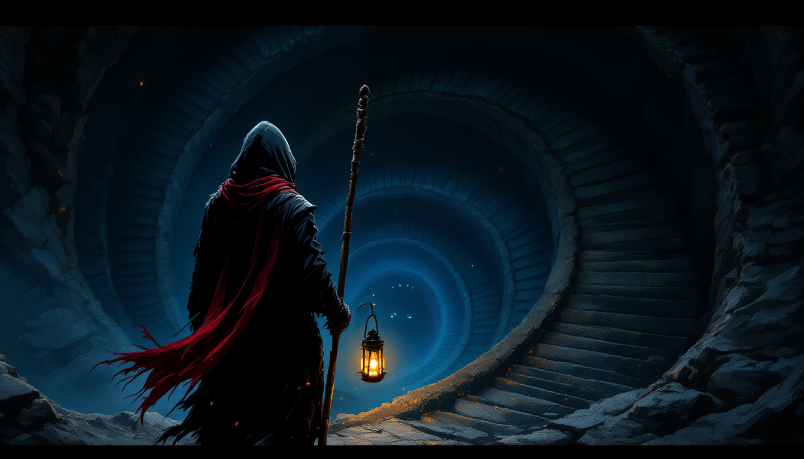

# Lanternfall

A top-down action dungeon crawler about the last lamplighter of a town that has never seen the sun. The Lantern has gone out, the dark is pressing at the windows, and Wren goes down after it with a lantern-staff and a flask of oil.

Built with Godot 4.3 for Windows and Android.



## Download

Get the latest build from the [Releases page](https://github.com/Ayan-sh03/lanternfall/releases/latest).

- **Windows:** download `Lanternfall.exe` and run it. It is a single file; nothing to install. Needs 64-bit Windows and a graphics driver with OpenGL 3.3.
- **Android:** download `Lanternfall.apk` on the phone and open it, allowing installs from your browser or file manager when asked. Needs Android 5.0 or later on a 64-bit ARM device.

## The game

- Seven depths, from the Lamp Cellars down to the Heartforge, each generated fresh for every descent.
- Six kinds of monster, elites that seal the stairs, a nemesis of your own making, and one Warden at the bottom.
- A three-hit staff combo, ember bolts that burn lamp oil, and a dash.
- Parries: strike a foe as it lunges or charges and it staggers; strike a hex out of the air and it flies back at whoever cast it.
- The lamp runs on the same oil as the bolts. The emptier the flask, the smaller the light, and below a fifth, shades called gloams come out of the dark until the lamp is bright again.
- Twenty-three kindlings to choose between as you level up, and relic powers found on the way down.
- Wayside lamps that heal you and save the run. Three save slots, and any depth you have reached can be started from again.
- Deaths that teach: the death screen shows what put you out and how to beat it, no single blow takes you from more than a heart to nothing, and the last heart gets a longer breath before the next hit. A foe winding up off screen or in the dark is marked at the edge of the screen.
- Nothing earned is lost. Every foe put out pays embers straight into your profile, kept through any death, to spend lighting lamps in the town above: nine of them, each a lasting help to every descent after (another heart, a deeper flask, a fourth kindling to choose from, a fresh choice once per depth, and more).
- Deeds, paid in embers, and a record of your best descents. After a few falls the lamp's resolve can be accepted, an optional easing that turns aside a few blows more for each fall, and put down again any time.
- Six kindlings that combine two you already hold into something new, such as Wildfire (burning foes set their neighbours alight) or Riposte (a parry makes the next strike land twice as hard).
- Wren remembers what put her out, and says so when she wakes.
- A nemesis: the first foe to put Wren out is given a name and keeps it. It wears a scrap of her cloak, waits for her on a later descent, taunts her when it sees her, and grows each time it puts her out again. Putting it out pays well and gives her the scrap back.
- Oil, fire, webs and water on the floor. Throw the flask and the oil pools where it lands; any fire (an ember bolt, a burning foe, a bursting Cinder Skull) sets it alight, and the fire spreads into oil and webs it touches. It burns whoever stands in it, Wren too. Webs slow everyone, charging foes slip in oil, and water puts out whatever burns.
- Snuff the lamp. Covered, it hides Wren: foes that cannot see her go to where they last did and cast about, she sees only their eyes and hears their steps, and a strike from the dark always lands twice as hard. Uncover it after a moment and it flares, dazzling everything near and lighting spilled oil. Hide too long and the gloams come, however full the flask.
- Flit, a lamp moth. Most floors have a wild one fluttering somewhere; offer it a drop of oil and it stays for the descent. It circles the lantern, flies off to light corners Wren has not seen yet, grows as it is fed (oil found, lamps lit), and once grown bites whatever comes near. Hexes can hit it, and if it dies it is gone.
- Hollow walls. Each floor hides a small sealed room with a hoard in it, behind one wall that breaks to a strike or a bolt. In the 3D view light seeps through the cracks of that wall and glows above the room; in the flat view nothing shows, but Flit flutters against it.
- Wren's echo: dash after a fight and the last two seconds of it play again where they happened, as a pale ghost of her whose blows land at half weight.
- Writings and plaques that tell what happened to the keepers, and two endings.

## Controls

| | Keyboard and mouse | Touch |
|---|---|---|
| Move | `W` `A` `S` `D` | Left thumb, anywhere on the left half |
| Aim | Mouse | Automatic; drag off STRIKE or BOLT to aim by hand |
| Strike | Left click (third strike is heavy) | Hold STRIKE |
| Ember bolt | Right click | Hold BOLT |
| Dash (and leave an echo) | `Space` | DASH |
| Throw oil | `X` or middle click | Flask stone |
| Turn the 3D camera | Middle-drag, or hold `[` `]`; wheel zooms, `Home` resets | |
| Snuff or relight the lamp | `C` | Hooded lamp stone |
| Relic powers | `Q` `R` `F` | Their stones, once found |
| Interact | `E` | The stone that appears beside a chest, lamp or stair |
| Pause | `Esc` | Pause stone, or the back gesture |

On desktop, `F11` toggles fullscreen and `M` mutes. The pause screen has switches for sound, a frame-rate readout and a faster, softer picture for weak graphics chips.

## Running from source

Install [Godot 4.3](https://godotengine.org/download/archive/4.3-stable/), then either open this folder in the editor and press play, or run:

```
godot --path .
```

Everything is loaded at run time, so there is no import step. All game code is in `scripts/`; the pixel art is drawn in code by `scripts/art.gd`.

## 3D view (prototype)

The game can be drawn in 3D: the same dungeon, monsters and combat, seen from a tilted camera with real walls, lights and shadows, and real rigged, animated figures for Wren, the skeletal keepers, cantors and Bellringers, and Maren (low-poly models by Kay Lousberg, CC0). Bats, ink and cinder skulls are still drawn as standing sprites. The camera turns around Wren (drag with the middle mouse button, or hold `[` and `]`) and zooms with the wheel; `Home` puts it back. Movement keys always mean "up the screen", however the camera is turned. `--billboards` brings back the flat cut-outs for every figure. Each release has a 3D build beside the classic one (`Lanternfall-3D.exe`, `Lanternfall-3D.apk`) that starts in 3D; the classic builds start flat. Press `F3` at any time in either to switch views. From source, `godot --path . -- --3d` starts in 3D.

The game rules themselves are untouched and still run on the 2D tile grid. `scripts/view3d.gd` watches that state each frame and draws it again in 3D: tiles become floor slabs and brick walls, sprites stand up in the world as cut-outs, 2D lights become point lights, and effects such as sweeps and warning rings become geometry. Walls between the camera and Wren dissolve so she is never hidden.

On top of that the 3D view adds bloom (bright embers, eyes and flames spill light), shadows thrown by every monster and prop away from Wren's lantern, and normal maps worked out from each sprite's outline so cloaks, bricks and slabs catch light from the side it comes from. Phones and the "fast" picture setting go without bloom and shadows; `--nobloom` turns bloom off on slow test machines.

`godot --path . -- --autotest --models --shotdir=<dir>` checks the 3D figures and the turning camera. `godot --path . -- --autotest --view3d --shotdir=<dir>` checks the 3D view: that the mouse aims exactly where it points, that switching views works, and saves screenshots.

## Building

Every push to `main` is built by GitHub Actions (`.github/workflows/build.yml`), which exports the Windows `.exe` and the signed Android `.apk` and publishes them as a release. The scripts it runs are in `ci/`.

The `.bat` files in the repository root (`Build Windows.bat`, `Build Android.bat`, `Install on Android.bat`) do the same locally, but they contain paths for the author's machine; change the paths at the top of each before using them. Building for Android also needs a JDK, the Android SDK and a signing key.

## Releasing

A release is published automatically for every build of `main`, named `v1.0.<build number>`. To publish under a version of your own choosing, push a tag that starts with `v`:

```
git tag v1.1
git push origin v1.1
```

## Credits and licence

The code and the original pixel art are released under the [MIT License](LICENSE).

The music and sound effects are CC0 recordings from OpenGameArt and Kenney, and the fonts (New Rocker and Jersey 10) are under the SIL Open Font License. They keep their own licences; the full list with authors and sources is in [CREDITS.txt](CREDITS.txt).
